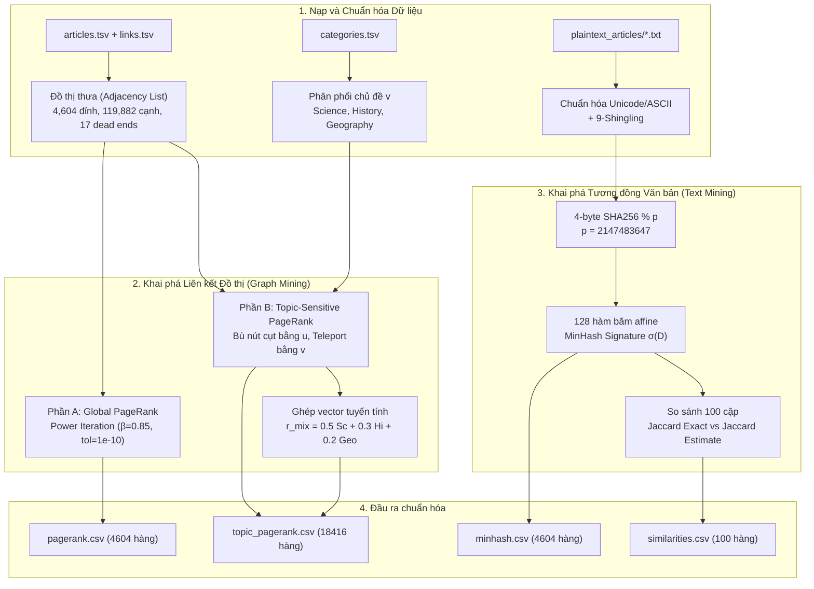

# BÁO CÁO PHÂN TÍCH CHI TIẾT ĐỀ BÀI BÀI TẬP WIKISPEEDIA
**Môn học:** Giải thuật Khoa học Dữ liệu (KHDL)  
**Địa điểm làm việc:** `C:\Users\HP\Downloads\HKI_2026-2027\GIẢI THUẬT KHDL\wikispeedia-student-package`

---

## 1. TỔNG QUAN, BỐI CẢNH VÀ MỤC TIÊU BÀI TẬP

### 1.1. Bối cảnh bài toán
Bộ dữ liệu **Wikispeedia** bắt nguồn từ một trò chơi trực tuyến thuộc dự án nghiên cứu của Đại học Stanford (SNAP - Stanford Network Analysis Project). Trong trò chơi, người chơi được cho trước một cặp bài viết Wikipedia (bài viết xuất phát và bài viết mục tiêu) và phải tìm đường đi ngắn nhất giữa hai bài viết đó chỉ bằng cách nhấp vào các liên kết nội bộ trong bài.

Gói bài tập này sử dụng phiên bản rút gọn chính thức của Wikipedia tiếng Anh gồm **4,604 bài viết**, bao gồm cả cấu trúc liên kết đồ thị và toàn bộ nội dung văn bản gốc.

### 1.2. Mục tiêu cốt lõi
Sinh viên cần tự tay cài đặt từ đầu (**from scratch**) ba thuật toán nền tảng trong lĩnh vực **Khai phá Dữ liệu Lớn (Mining of Massive Datasets)**:
1. **Global PageRank (Phần A - 30 điểm):** Phân tích liên kết đồ thị có hướng quy mô lớn bằng phương pháp lặp lũy thừa (*Power Iteration*) trên biểu diễn ma trận/danh sách kề thưa (*Sparse Graph*).
2. **Topic-Sensitive PageRank & Vector Mixing (Phần B - 30 điểm):** Phân tích đồ thị cá nhân hóa theo chủ đề và ứng dụng tính chất tuyến tính của phương trình PageRank để ghép nghiệm.
3. **K-Shingling & Chữ ký MinHash (Phần C - 35 điểm):** Biểu diễn nén tập hợp và ước lượng độ tương đồng tập hợp (*Jaccard Similarity*) giữa các tài liệu văn bản bằng họ hàm băm ngẫu nhiên affine.
4. **Quy chuẩn thực thi, tính tái lập và I/O (Chung - 5 điểm):** Tự động hóa toàn bộ quy trình sinh 4 tệp kết quả CSV theo đúng đặc tả.

> [!IMPORTANT]
> **Quy định về thư viện:**
> - Nghiêm cấm dùng các thư viện có sẵn hàm hoàn chỉnh như `networkx.pagerank`, `scipy.sparse.csgraph`, `datasketch`, `scikit-learn`.
> - Cho phép dùng thư viện chuẩn Python 3.10+ và NumPy/SciPy cho việc lưu trữ, tính toán vector/ma trận cơ bản.
> - Thuật toán phải mang tính tổng quát: tuyệt đối không gắn cứng số đỉnh, số cạnh, tham số hoặc dữ liệu kiểm thử.

---

## 2. DỮ LIỆU ĐỀ BÀI VÀ THỐNG KÊ CHÍNH XÁC

### 2.1. Cấu trúc thư mục gói bài tập

```
wikispeedia-student-package/
│
├── README.md                          # Hướng dẫn nhanh môi trường và lệnh chạy
├── bai-tap-wikispeedia.md             # Đặc tả chi tiết đề bài, công thức và thang điểm
├── autograder.py                      # Bộ tự chấm 13 tiêu chí (tối đa 100 điểm)
├── SHA256SUMS.txt                     # Checksum kiểm tra toàn vẹn gói bài tập
├── submission.py                      # Mã nguồn bài làm chính thức của sinh viên
│
├── assignment/
│   ├── submission_template.py         # Template ban đầu có docstring chi tiết
│   ├── minhash_params.json            # Cấu hình 128 hàm băm affine (p = 2147483647)
│   └── pairs_sample.csv               # Bộ 4 cặp mẫu để kiểm tra sơ bộ
│
├── data/
│   ├── pairs.csv                      # Bộ 100 cặp bài viết chính thức để so sánh Jaccard
│   ├── wikispeedia_paths-and-graph.tar.gz  # Đồ thị và phân loại danh mục (9.9 MB)
│   └── wikispeedia_articles_plaintext.tar.gz # Toàn bộ văn bản 4,604 bài viết (35.8 MB)
│
└── output/                            # Thư mục chứa 4 tệp CSV kết quả nộp bài
    ├── pagerank.csv                   # 4,604 dòng dữ liệu
    ├── topic_pagerank.csv             # 18,416 dòng dữ liệu (3 chủ đề + r_mix)
    ├── minhash.csv                    # 4,604 dòng dữ liệu (shingle count + 128 chữ ký)
    └── similarities.csv               # 100 dòng dữ liệu (Jaccard exact vs estimate)
```

### 2.2. Số liệu kiểm định dữ liệu thực tế (Verified Dataset Facts)
Dữ liệu kiểm tra thực tế trên gói chính thức:
- **Số đỉnh (Articles):** Đúng **4,604 đỉnh**.
  - Quy ước: Lấy từ `articles.tsv`. Giữ nguyên mã hóa phần trăm (Percent-encoding, ví dụ `%C3%89douard_Manet`, không giải mã URL).
  - Thứ tự: Sắp xếp theo thứ tự từ điển của **byte UTF-8** (`article.encode('utf-8')`).
- **Số cạnh (Directed Links):** Đúng **119,882 cạnh có hướng phân biệt** (lấy từ `links.tsv`).
  - Gộp cạnh lặp trùng (duplicate edges).
  - Giữ nguyên cạnh tự nối (**110 cạnh self-loops**).
  - Phát hiện đúng **17 nút cụt (dangling nodes / dead ends)** có bậc ra $d_j = 0$.
- **Phân loại chủ đề (`categories.tsv`):**
  - **Science** (`subject.Science`): **1,105 bài viết** phân biệt.
  - **History** (`subject.History`): **525 bài viết** phân biệt.
  - **Geography** (`subject.Geography`): **1,063 bài viết** phân biệt.
  - Quy tắc so khớp: Nhãn bằng đúng tiền tố hoặc bắt đầu bằng `prefix + "."`. Một bài viết có nhiều nhãn con trong cùng chủ đề chỉ được tính một lần.
- **Tập văn bản:** Đúng **4,604 tệp** định dạng `.txt` tương ứng với 4,604 ID bài viết.
- **Bộ 100 cặp so sánh (`pairs.csv`):**
  - 10 cặp tự so sánh ($A \equiv A \implies \text{Jaccard} = 1.0$).
  - 30 cặp có độ tương đồng cao đã khảo sát trước.
  - 30 cặp có chung một nhãn chủ đề cấp cao nhất.
  - 30 cặp lấy ngẫu nhiên không chung chủ đề.

---

## 3. PHÂN TÍCH CHUYÊN SÂU CÁC THUẬT TOÁN DỮ LIỆU LỚN



---

### 3.1. Thuật toán 1: PageRank Toàn cục trên Đồ thị Thưa (Global PageRank)
- **Mô hình toán học:** Xích Markov biểu diễn hành vi của người lướt web ngẫu nhiên (*Random Surfer*).
- **Vấn đề đồ thị lớn:**
  1. *Spider Traps:* Người duyệt web bị kẹt trong một chu trình liên kết. Xử lý bằng hệ số dịch chuyển ngẫu nhiên (damping factor $\beta = 0.85$, dịch chuyển ngẫu nhiên $1 - \beta = 0.15$).
  2. *Dead Ends (Nút cụt):* Các đỉnh không có liên kết ngoài ($d_j = 0$) làm thất thoát tổng khối lượng xác suất qua mỗi vòng lặp.
- **Công thức cập nhật đồng thời:**
  $$r_i^{t+1} = \beta \sum_{j \to i} \frac{r_j^t}{d_j} + \beta \delta_t \frac{1}{n} + (1-\beta)\frac{1}{n}$$
  Trong đó:
  - $n = 4604$: số lượng đỉnh.
  - $d_j$: bậc ra của đỉnh $j$ ($d_j > 0$).
  - $\delta_t = \sum_{j \in \text{dead\_ends}} r_j^t$: tổng trọng số xác suất tích tụ tại các nút cụt ở bước $t$.
  - Khởi tạo: $r_i^0 = \frac{1}{n}$ với mọi $i$.
  - Tiêu chí dừng: $\lVert r^{t+1} - r^t \rVert_1 = \sum_{i=1}^n |r_i^{t+1} - r_i^t| \le 10^{-10}$ hoặc đạt $t = 1000$.
- **Lưu ý triển khai Big Data:** Tuyệt đối không dựng ma trận $4604 \times 4604$ dạng đặc (dense matrix) tốn bộ nhớ. Sử dụng danh sách kề để lan truyền điểm theo từng cạnh với độ phức tạp thời gian $O(|E|)$ cho mỗi vòng lặp.

---

### 3.2. Thuật toán 2: Topic-Sensitive PageRank & Vector Mixing
- **Bản chất thuật toán:** Thay vì dịch chuyển đều về toàn bộ mạng lưới, người duyệt web có xu hướng dịch chuyển ưu tiên về các trang thuộc chủ đề quan tâm $S$.
- **Vector dịch chuyển chủ đề $v$:**
  $$v_i = \begin{cases} \frac{1}{|S|}, & \text{nếu } i \in S \\ 0, & \text{ngược lại} \end{cases}$$
- **Công thức cập nhật theo chủ đề:**
  $$r_i^{t+1} = \beta \sum_{j \to i} \frac{r_j^t}{d_j} + \beta \delta_t \frac{1}{n} + (1-\beta) v_i$$
  
  > [!WARNING]
  > **Quy ước đặc thù sống còn:**
  > - Bù nút cụt $\beta \delta_t \frac{1}{n}$ **luôn theo phân phối đều $u = \frac{1}{n}$**, KHÔNG bù theo phân phối chủ đề $v$.
  > - Chỉ có thành phần nhảy ngẫu nhiên $(1-\beta)$ mới nhân với $v_i$.
  > - Các trang nằm ngoài chủ đề $S$ vẫn nhận và truyền điểm bình thường thông qua liên kết.

- **Tính chất tuyến tính (Linearity) & Phép ghép vector:**
  Phương trình PageRank ở trạng thái dừng là:
  $$r = \beta M r + \beta \delta_r u + (1-\beta) v$$
  Do tính chất tuyến tính của hệ phương trình, nếu vector dịch chuyển là tổ hợp lồi $v_{\text{mix}} = \sum_k w_k v_k$ với $\sum w_k = 1, w_k \ge 0$, thì nghiệm dừng tương ứng thỏa mãn:
  $$r_{\text{mix}} = \sum_k w_k r_k$$
  Cụ thể với bài tập:
  $$r_{\text{mix}} = 0.5 \cdot r_{\text{Science}} + 0.3 \cdot r_{\text{History}} + 0.2 \cdot r_{\text{Geography}}$$
  Kết quả ghép trực tiếp này khớp nghiệm số học với việc chạy lại toàn bộ thuật toán PageRank từ $v_{\text{mix}}$.

---

### 3.3. Thuật toán 3: K-Shingling, MinHash và Ước lượng Tương đồng Jaccard
- **Bài toán:** Tính độ tương đồng văn bản giữa hàng nghìn tài liệu kích thước lớn. Nếu so sánh trực tiếp văn bản hoặc so sánh tập hợp thô thì chi phí lưu trữ và thời gian sẽ bùng nổ.
- **Quy trình 3 bước chuẩn hóa:**
  1. **Tiền xử lý chuỗi (`normalize_text`):**
     - Đổi ASCII `A`-`Z` thành `a`-`z`.
     - **Không** đổi chữ có dấu Unicode (ví dụ `É` giữ nguyên `É`, không chuyển thành `é`).
     - Gộp mọi khoảng trắng liên tiếp trong tập `[ \t\n\r\v\f]` thành đúng một khoảng trắng ASCII `' '`.
     - Cắt bỏ khoảng trắng ở hai đầu chuỗi.
  2. **Tập $k$-shingle:**
     - Lấy cửa sổ trượt $k = 9$ ký tự Unicode liên tiếp (Unicode code points, không tính theo byte).
     - Loại bỏ phần tử trùng lặp (`set`). Nếu chuỗi $< 9$ ký tự, trả về tập rỗng.
  3. **Băm Shingle sang số nguyên (`shingle_id`):**
     - Lấy băm SHA-256 trên chuỗi byte UTF-8 của shingle.
     - Lấy 4 byte đầu tiên, chuyển đổi thành số nguyên không dấu big-endian.
     - Lấy modulo cho số nguyên tố Mersenne $p = 2^{31} - 1 = 2147483647$.
  4. **Chữ ký MinHash (`minhash`):**
     - Sử dụng 128 hàm băm affine cung cấp sẵn trong `minhash_params.json`:
       $$h_j(x) = (a_j x + b_j) \bmod p, \quad j = 0, \dots, 127$$
     - Chữ ký $\sigma(D)$ của tài liệu $D$ gồm 128 tọa độ:
       $$\sigma_j(D) = \min_{s \in S_9(D)} h_j(x(s))$$
     - Trường hợp tập rỗng: Gán toàn bộ 128 tọa độ bằng $p$ (giá trị sentinel).
  5. **Đo lường & Ước lượng:**
     - **Jaccard chính xác:**
       $$J(A, B) = \frac{|S_A \cap S_B|}{|S_A \cup S_B|}$$
     - **Định lý MinHash:** Xác suất để hai chữ ký ngẫu nhiên trùng nhau đúng bằng hệ số tương đồng Jaccard:
       $$P(h_j(A) = h_j(B)) = J(A, B)$$
     - **Ước lượng qua chữ ký:**
       $$\hat{J}(A, B) = \frac{1}{128} \sum_{j=0}^{127} \mathbb{I}(\sigma_j(A) == \sigma_j(B))$$
     - Quy ước trường hợp biên: Cả 2 tập rỗng $\implies 1.0$; 1 tập rỗng, 1 tập không rỗng $\implies 0.0$.

---

## 4. CHI TIẾT BẢNG ĐIỂM (100 ĐIỂM) VÀ ĐỐI CHIẾU KIỂM THỬ

| Mã | Nội dung kiểm thử | Điểm | Kết quả thực tế | Ghi chú kỹ thuật |
|---|---|:---:|:---:|---|
| **A1** | Đọc đồ thị: đủ đỉnh, đúng hướng, gộp trùng, giữ self-loop | 5 | **5/5** | Đạt chuẩn 4,604 đỉnh, 119,882 cạnh, kiểm tra bắt lỗi `ValueError` khi ID ngoài tập đỉnh |
| **A2** | Một vòng cập nhật PageRank đúng, có nút cụt | 8 | **8/8** | Khớp chính xác công thức bù nút cụt với nghiệm oracle |
| **A3** | Vector hội tụ khớp nghiệm trên đồ thị nhỏ & Wikispeedia | 12 | **12/12** | Sai số $L_1 < 10^{-8}$ so với nghiệm tham chiếu khử Gauss và toán tử thưa |
| **A4** | Tiêu chuẩn dừng và bảo toàn bất biến xác suất | 5 | **5/5** | Tổng điểm bằng 1.0 (sai số $< 10^{-10}$), không có điểm âm, bất biến hoán vị |
| **B1** | Tập chủ đề và phân phối $v$ đúng, xử lý nhãn trùng | 6 | **6/6** | Lọc đúng tiền tố, không tính trùng, bắt lỗi tập rỗng hoặc nhãn ngoài tập đỉnh |
| **B2** | Cập nhật theo chủ đề, bù nút cụt theo phân phối đều $u$ | 10 | **10/10** | Đúng công thức kết hợp teleport $v$ và bù nút cụt $u$ |
| **B3** | Vector nghiệm cho 3 chủ đề khớp nghiệm tham chiếu | 9 | **9/9** | Khớp chính xác nghiệm trên toàn bộ 4,604 đỉnh của Wikispeedia |
| **B4** | Ghép chủ đề đúng, khớp nghiệm chạy từ $v_{\text{mix}}$ | 5 | **5/5** | Thỏa mãn tính chất tuyến tính của PageRank |
| **C1** | Chuẩn hóa chuỗi và tập shingle đúng quy cách | 8 | **8/8** | Đúng quy tắc phân biệt ASCII lower và Unicode, regex khoảng trắng |
| **C2** | Mã shingle, hàm băm và chữ ký MinHash khớp từng số nguyên | 17 | **17/17** | Khớp chính xác 100% 128 số nguyên với nghiệm tham chiếu của toàn kho |
| **C3** | Jaccard chính xác và tỷ lệ tọa độ trùng trên 100 cặp | 6 | **6/6** | Tính toán chính xác trên toàn bộ bộ 100 cặp chính thức `pairs.csv` |
| **C4** | Trường hợp biên, tập rỗng, tính chất phép min | 4 | **4/4** | Bảo toàn tính bất biến: $\sigma(A \cup B) = \min(\sigma(A), \sigma(B))$ |
| **IO** | Thực thi `main()`, sinh 4 CSV chuẩn, tính tái lập | 5 | **5/5** | Định dạng số `.17g`, kiểm tra kích thước và số dòng các tệp CSV |
| **TỔNG** | | **100** | **100/100** | **ĐẠT ĐIỂM TUYỆT ĐỐI** |

---

## 5. KẾ HOẠCH HỖ TRỢ VÀ LỘ TRÌNH THỰC HIỆN BÀI TẬP

Để giúp bạn hoàn thành xuất sắc bài tập và tự tin nắm vững bản chất giải thuật khi bảo vệ hoặc làm báo cáo, lộ trình thực hiện được chia thành 4 giai đoạn cụ thể:

### Giai đoạn 1: Chuẩn bị môi trường & Dữ liệu
1. **Kiểm tra môi trường Python:**
   - Yêu cầu tối thiểu: Python 3.10+.
   - Cài đặt NumPy (khuyến nghị phiên bản $\ge 1.24$ hoặc mới nhất) để tăng tốc tính toán vector trong MinHash.
2. **Giải nén dữ liệu bắt buộc:**
   ```bash
   tar -xzf data/wikispeedia_paths-and-graph.tar.gz -C data
   tar -xzf data/wikispeedia_articles_plaintext.tar.gz -C data
   ```
   > [!TIP]
   > Giải nén trực tiếp 4,604 tệp `.txt` vào `data/plaintext_articles/` giúp bài làm và bộ tự chấm đọc file nhanh hơn gấp 20 lần so với việc đọc trực tiếp trong archive `.tar.gz`, tránh nguy cơ bị `TimeoutError` ở nhóm C3.

### Giai đoạn 2: Cài đặt và Tối ưu hóa Giải thuật trong `submission.py`
1. **Mô-đun Đồ thị & PageRank (Phần A):**
   - Cài đặt `load_graph`: Dùng `set()` để loại trùng cạnh, danh sách kề `out_neighbors`.
   - Cài đặt `pagerank`: Tối ưu hóa tính tổng đóng góp điểm nút cụt `dangling` trước mỗi vòng lặp. Cập nhật đồng thời vector điểm qua vòng lặp duyệt đỉnh.
2. **Mô-đun Chủ đề & Ghép nghiệm (Phần B):**
   - Cài đặt `topic_distribution`: Đọc `categories.tsv`, lọc tiền tố `subject.<Name>`, gán xác suất đều $\frac{1}{|S|}$.
   - Cài đặt `mix_pageranks`: Nhân tích vô hướng giữa trọng số `[0.5, 0.3, 0.2]` và vector điểm các chủ đề.
3. **Mô-đun Chuẩn hóa, Shingling & MinHash (Phần C):**
   - Cài đặt `normalize_text`: Dùng bảng chuyển đổi ASCII và regex gộp khoảng trắng.
   - Cài đặt `shingles` và `shingle_id`: Trích xuất 9 code-points, băm SHA-256 4 byte đầu.
   - Cài đặt `minhash`: Áp dụng vector hóa với NumPy `np.fromiter` và tính `np.min` theo từng hàm băm affine để đạt tốc độ xử lý nhanh nhất.
   - Cài đặt `jaccard` và `signature_similarity`: Đảm bảo quy tắc trường hợp biên khi tập hợp rỗng.

### Giai đoạn 3: Tự chấm và Kiểm thử Tính ổn định
1. **Chạy tự chấm với `autograder.py`:**
   ```bash
   python autograder.py submission.py --timeout 300 --report grading_reports/self_check.json
   ```
2. **Kiểm tra báo cáo JSON:** Đảm bảo tất cả 13 tiêu chí đều đạt điểm tối đa và không có ngoại lệ.

### Giai đoạn 4: Sinh dữ liệu kết quả và Đóng gói nộp bài
1. **Chạy sinh 4 tệp kết quả trong `output/`:**
   ```bash
   python submission.py --data-dir data --output-dir output
   ```
2. **Kiểm tra số dòng dữ liệu (không tính header):**
   - `output/pagerank.csv`: Đúng 4,604 dòng.
   - `output/topic_pagerank.csv`: Đúng 18,416 dòng.
   - `output/minhash.csv`: Đúng 4,604 dòng.
   - `output/similarities.csv`: Đúng 100 dòng.
3. **Thành phần nộp bài:**
   - 01 tệp mã nguồn: `submission.py`.
   - 04 tệp CSV trong thư mục `output/`.
